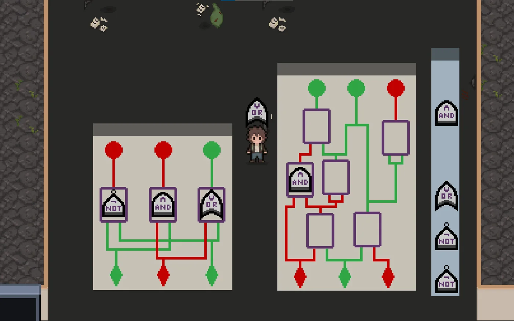
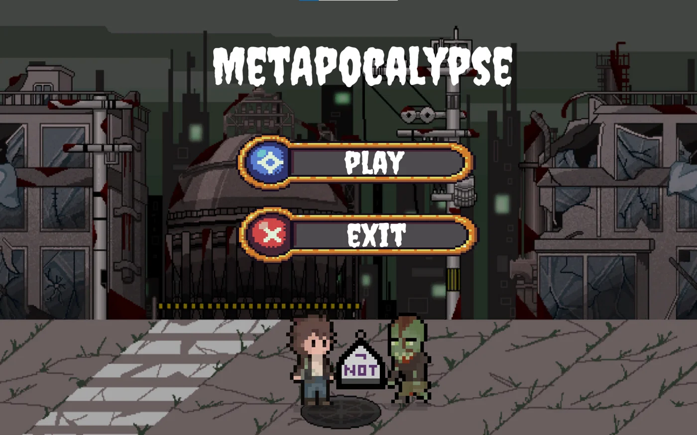
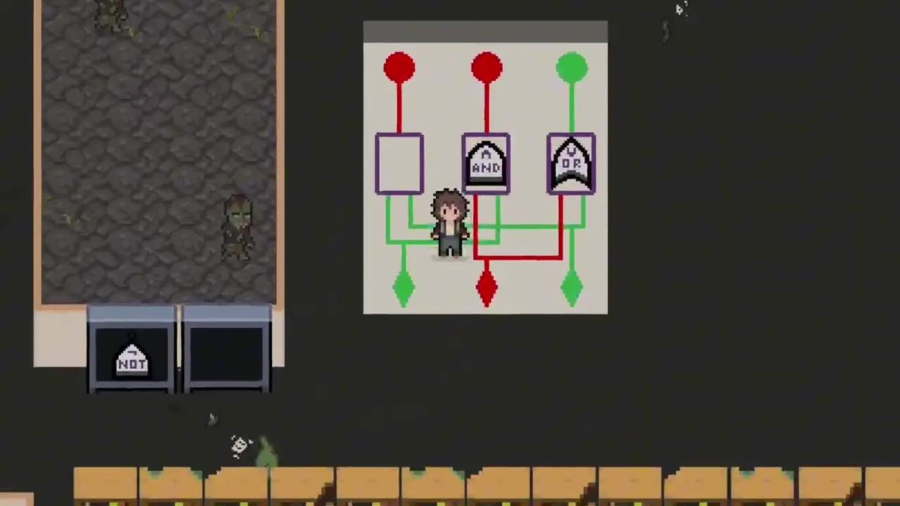

# MetApocalypse: the logic gate puzzle (Unity, C#)

MetApocalypse is a 2D puzzle game set in the MetaForum building at Eindhoven University of Technology. We made it in the course **Design for Games and Play II** with a team of five, to get incoming computer science students excited about first-year topics. The player explores the building and collects machine parts by solving puzzles based on real course material, such as logic gates and state machines.

> This repository contains only the scripts, pixel art and animations I made, not the whole Unity project, so it will not run on its own. A gameplay video is on my [portfolio](https://AngelovaM2.github.io/#games).

## What I made

- **The logic gate puzzle.** The player picks up AND, OR and NOT gates and places them into slots on a circuit panel. When every slot holds the right gate, the panel opens and gives a reward.
- **The puzzle tutorial.** It teaches the puzzle in three steps (AND, then AND and OR, then all three) and opens the next gate cabinet each time.
- **Character movement**, animations and footstep sounds.
- **The pick-up system** for machine parts, notes and puzzle items.
- **The main menu**, and together with a teammate the checklist UI that shows which parts you have collected.
- **Pixel art and animations** for the puzzle in Aseprite: the gates, panels, doors, cabinet and ventilation shaft. This made me fall in love with pixel art on another level.

## How the puzzle code fits together

| Script | Role |
|---|---|
| `Logic Puzzle/GateType.cs` | An enum with the three gate types: `AND`, `OR`, `NOT` |
| `Logic Puzzle/CarryableItem.cs` | A gate the player can pick up (E) and drop (F); it follows the player while carried |
| `Logic Puzzle/Slot.cs` | A slot on the panel that knows which gate it needs; shows "pick up" or "place" hints and swaps gates with the player |
| `Logic Puzzle/LogicGatePuzzleTutorial.cs` | The three-step tutorial: unlocks the next gate cabinet after each step and plays the reward |
| `Logic Puzzle/LogicGatePuzzle.cs` | The main puzzle: checks every slot after a gate is placed and opens the reward when all are correct |
| `Character/CharacterController.cs`, `CharacterWalking.cs` | Movement, animation and footstep sounds |
| `PickableItem.cs` | Picking up parts, notes and puzzle items |
| `PartsChecklist.cs` | Fills the sidebar checklist with the parts in the level |
| `MainMenu.cs` | The start screen (Play and Exit) |

The `Art/` folder has the sprites used in the game, and `Art/aseprite-sources/` has my original Aseprite files.

## What I learned

Connecting scripts with Unity's attributes was a parade of oops moments, but in the end every playtester managed to solve the puzzle. Their feedback also showed me what was missing: the circuit did not show which direction it flows, and the tutorial needed a hint to get started. Collaborating through GitHub was a "fun" learning experience too. Merging tilemap work from two branches is a mistake I will not repeat.

If I continued the project, I would add notes that lead the player to the puzzle, and I would make the puzzle checker count the correct slots locally on every check instead of keeping a counter between checks.

---

Made by **Mariana Angelova** as part of a team of five · [Portfolio](https://AngelovaM2.github.io)
